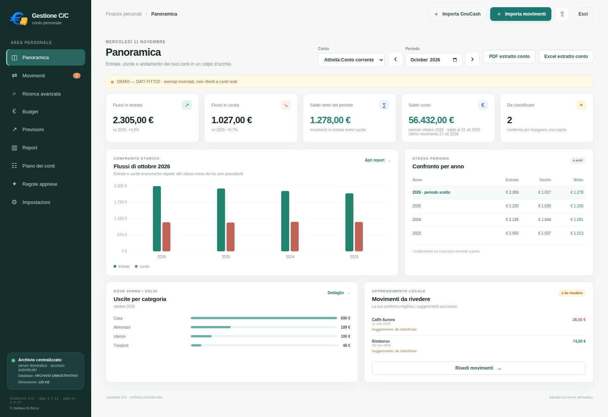
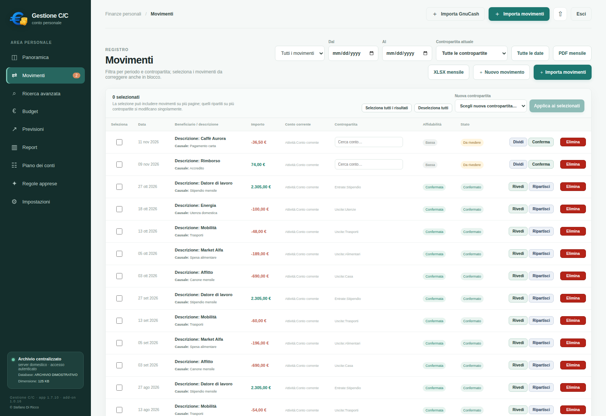
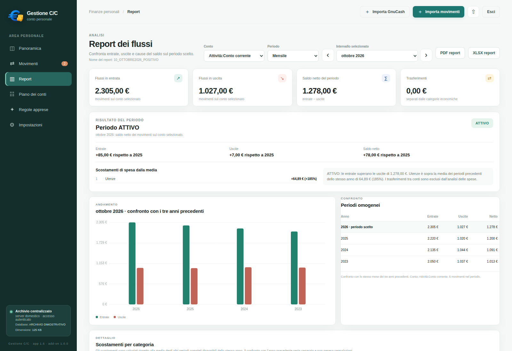

# Gestione C/C — Home Assistant App

  

  <strong>Gestione personale dei conti · Personal finance management</strong> 
  <strong>Distribuzione Home Assistant 1.0.6 · Applicazione 1.7.2</strong>

**Italiano · English**

> [!IMPORTANT]
> **SCHERMATE DIMOSTRATIVE — DATI FITTIZI**
>
> Le immagini di questo README sono schermate dell'interfaccia di Gestione C/C popolate con dati esclusivamente dimostrativi. Nomi, conti, saldi, date, movimenti e importi sono inventati e non rappresentano archivi bancari o dati personali reali.

## Anteprima

| Panoramica finanziaria | Registro movimenti | Report |
|:---:|:---:|:---:|
|  |  |  |
| Entrate, uscite, saldi e andamento. | Consultazione, ricerca e classificazione. | Analisi e confronti tra periodi. |

---

## Indice / Contents

- [Italiano](#italiano)
  - [Cos'è Gestione C/C](#cosè-gestione-cc)
  - [Funzionalità](#funzionalità)
  - [Requisiti](#requisiti)
  - [Installazione](#installazione)
  - [Primo avvio e configurazione](#primo-avvio-e-configurazione)
  - [Dati, importazione ed esportazione](#dati-importazione-ed-esportazione)
  - [Backup e ripristino](#backup-e-ripristino)
  - [Sicurezza e privacy](#sicurezza-e-privacy)
  - [Aggiornamenti](#aggiornamenti)
  - [Supporto e licenza](#supporto-e-licenza)
- [English](#english)
  - [What is Gestione C/C](#what-is-gestione-cc)
  - [Features](#features)
  - [Requirements](#requirements)
  - [Installation](#installation)
  - [First start and configuration](#first-start-and-configuration)
  - [Data, import and export](#data-import-and-export)
  - [Backup and restore](#backup-and-restore)
  - [Security and privacy](#security-and-privacy)
  - [Updates](#updates)
  - [Support and licence](#support-and-licence)

---

# Italiano

## Cos'è Gestione C/C

Gestione C/C è un'applicazione web per la gestione e l'analisi dei conti personali. Questa distribuzione la rende disponibile come **Home Assistant App** (in precedenza denominata add-on), con un archivio SQLite persistente conservato sul server Home Assistant e un'interfaccia web accessibile dai dispositivi autorizzati della rete locale.

L'obiettivo è offrire un ambiente unico in cui registrare e classificare i movimenti, consultare i saldi, analizzare entrate e uscite, gestire budget e previsioni e produrre report periodici.

**Gestione C/C è un'App di Home Assistant, non un'integrazione, una scheda Lovelace o un plugin del Marketplace.** Non crea entità o dispositivi Home Assistant: funziona come applicazione web autonoma.

### Versioni

| Componente | Versione |
|---|---:|
| Distribuzione Home Assistant App | **1.0.6** |
| Applicazione Gestione C/C inclusa | **1.7.2** |

Le due numerazioni sono indipendenti: la prima identifica il pacchetto Home Assistant, la seconda l'applicazione finanziaria.

## Funzionalità

### Panoramica finanziaria
- Riepilogo di entrate, uscite e saldo.
- Consultazione dei conti e dei relativi saldi.
- Analisi dell'andamento finanziario nel tempo.
- Consultazione dei dati per il periodo selezionato.
- Esportazione dell'estratto conto relativo al periodo e al conto selezionati.

### Movimenti
- Inserimento e consultazione dei movimenti.
- Ricerca e filtri per intervallo di date.
- Consultazione cronologica anche su periodi storici estesi.
- Classificazione dei movimenti tramite il piano dei conti.
- Movimenti suddivisi tra più conti o categorie, per rappresentare correttamente operazioni composte.
- Gestione delle contropartite e delle descrizioni.

### Piano dei conti
- Struttura gerarchica con conti e sottoconti.
- Supporto alla struttura dei conti importata da GnuCash.
- Rinomina dei conti con attenzione alla continuità dei riferimenti storici.
- Tag multipli per identificare e organizzare i conti, ad esempio conti principali, secondari, inattivi o da verificare.
- Consultazione delle categorie economiche e patrimoniali.

### Budget e previsioni
- Gestione del budget per periodo e categoria.
- Confronto tra importi previsti e importi effettivi.
- Consultazione degli scostamenti e dei margini.
- Analisi delle previsioni di liquidità e dei flussi attesi.
- Possibilità di distinguere la classificazione economica dai movimenti che incidono sulla liquidità, secondo la configurazione dei conti.

### Report e analisi
- Report finanziari per periodo.
- Confronto tra periodi e analisi degli scostamenti.
- Analisi delle entrate e delle uscite per categoria.
- Consultazione delle informazioni aggregate secondo la gerarchia del piano dei conti.
- Esportazione in XLSX e stampa/esportazione PDF tramite il browser.

### Importazione ed esportazione
- Importazione di archivi GnuCash e dei formati di movimento supportati dall'interfaccia.
- Importazione di file QIF, CSV e XLSX nei formati compatibili.
- Esportazione dei dati e dei report nei formati previsti dall'applicazione.
- Verifica dei risultati dell'importazione consigliata prima di utilizzare l'archivio come riferimento contabile.

### Archivio centralizzato
- Database SQLite persistente sul server Home Assistant.
- Accesso allo stesso archivio dai browser autorizzati.
- Backup JSON e SQLite.
- Backup locali automatici.
- Collegamento facoltativo a Google Drive per conservare copie di sicurezza esterne.

## Requisiti

- Home Assistant OS con Supervisor e supporto alle App.
- Architettura supportata: `amd64` oppure `aarch64`.
- Porta TCP **8443** disponibile sul server.
- Rete locale raggiungibile dai dispositivi client.
- Nome host locale risolvibile dai dispositivi utilizzati.
- Subnet LAN corretta configurata nell'opzione `lan_network`.
- Browser moderno con JavaScript abilitato.

## Installazione

1. In Home Assistant apri **Impostazioni → App**.
2. Apri il menu in alto a destra e seleziona **Repository**.
3. Aggiungi questo indirizzo:

   `https://github.com/stefanodr/gestione-cc-home-assistant`

4. Aggiorna l'elenco delle App.
5. Cerca **Gestione C/C** e seleziona **Installa**.
6. Prima del primo avvio configura le opzioni descritte di seguito.
7. Avvia l'App e attendi il completamento dell'inizializzazione.

## Primo avvio e configurazione

Le opzioni principali sono:

| Opzione | Valore predefinito | Descrizione |
|---|---|---|
| `admin_username` | `admin` | Nome dell'utente amministratore iniziale. |
| `bootstrap_pin` | vuoto | PIN temporaneo iniziale, composto da esattamente 6 cifre. |
| `hostname` | `homeassistant.local` | Nome host locale incluso nel certificato HTTPS. Deve essere risolvibile dai client. |
| `lan_network` | `192.168.1.0/24` | Subnet CIDR autorizzata. Deve corrispondere alla rete effettiva. |

**Non copiare automaticamente il valore predefinito di `lan_network`:** sostituiscilo con la subnet reale della tua rete. Una configurazione non corretta può impedire l'accesso o non rappresentare la topologia di rete vista dal container.

### Accesso all'interfaccia

Dopo l'avvio, apri dal browser di un dispositivo della LAN:

`https://<hostname-locale>:8443`

Ad esempio:

`https://homeassistant.local:8443`

L'indirizzo è valido solo se il nome host è effettivamente risolvibile nella rete locale.

### PIN e certificato HTTPS

- Al primo avvio è richiesto un PIN iniziale di **6 cifre**.
- L'interfaccia utilizza HTTPS sulla porta TCP 8443.
- Il certificato è firmato da una CA privata generata dall'App: al primo collegamento il browser può mostrare un avviso.
- Accedi solo dalla rete locale, scarica la CA dalla pagina di login o dalle Impostazioni e installala sui dispositivi autorizzati.
- Dopo la migrazione iniziale delle credenziali, svuota il campo `bootstrap_pin` nelle opzioni dell'App.
- Non condividere PIN, certificati privati o chiavi.

La procedura completa è disponibile nel [manuale dell'App](gestione_cc/DOCS.md).

## Dati, importazione ed esportazione

Il database principale è conservato nel volume persistente dell'App, nel percorso:

`/data/gestione_cc.sqlite3`

L'archivio contiene i dati contabili e le impostazioni applicative. Gli aggiornamenti ordinari dell'App non richiedono di eliminare o ricreare il database.

### Importazione da GnuCash

Gestione C/C prevede l'importazione di archivi GnuCash. La compatibilità può dipendere dalla struttura e dalla versione del file sorgente.

Prima di importare:
1. conserva una copia intatta del file originale;
2. crea un backup dell'archivio Gestione C/C;
3. esegui l'importazione secondo la modalità prevista dall'interfaccia;
4. controlla conti, saldi, date e movimenti suddivisi;
5. confronta i totali con il programma o l'archivio di origine.

Non utilizzare l'importazione come sostituto di una verifica contabile.

### Esportazioni

I report e gli estratti conto possono essere esportati nei formati disponibili nell'applicazione. La stampa PDF utilizza la finestra standard del browser: seleziona una stampante oppure **Salva come PDF**.

Gli estratti conto PDF e XLSX seguono il periodo selezionato nella Panoramica. Controlla il conto e l'intervallo temporale prima di generare un documento.

## Backup e ripristino

La protezione dell'archivio è essenziale perché contiene informazioni finanziarie personali.

### Backup locale
- L'applicazione supporta backup JSON e SQLite.
- Le copie automatiche locali vengono conservate nel volume persistente dell'App.
- I backup locali sullo stesso server non sostituiscono una copia esterna.

### Backup facoltativo su Google Drive
È disponibile una funzione opzionale per conservare backup SQLite nel proprio account Google Drive.

La procedura richiede una configurazione OAuth personale e l'autorizzazione tramite rclone su un PC Windows. Non è necessario esporre Home Assistant a Internet e il collegamento non rende pubblica l'interfaccia web.

Guida completa, in italiano e inglese: [Backup Google Drive](docs/GOOGLE_DRIVE_BACKUP.md).

**Attenzione alla riservatezza:** i file SQLite trasferiti su Google Drive non sono cifrati dall'applicazione. Chiunque abbia accesso al tuo account e ai file di backup può leggerne il contenuto. Proteggi l'account Google e non condividere i file.

### Buone pratiche
1. Crea backup prima di aggiornamenti importanti o importazioni.
2. Conserva almeno una copia fuori dal server Home Assistant.
3. Proteggi i supporti e gli account che contengono i backup.
4. Prima di ripristinare, crea una copia dello stato corrente.
5. Se hai dubbi su un archivio, prova il ripristino su un'istanza di test e non sul database principale.

Per i dettagli operativi consulta il [manuale](gestione_cc/DOCS.md) e la [guida Google Drive](docs/GOOGLE_DRIVE_BACKUP.md).

## Sicurezza e privacy

Gestione C/C è progettata per un utilizzo personale in rete locale.

- Interfaccia HTTPS sulla porta TCP 8443.
- Autenticazione tramite PIN amministratore di 6 cifre.
- Verifica del PIN mediante PBKDF2-HMAC-SHA256 con salt casuale.
- Cookie di sessione con attributi HttpOnly, Secure e SameSite=Strict.
- Protezione CSRF sulle operazioni che modificano i dati.
- Limitazione dei tentativi di accesso.
- Controlli di revisione per ridurre il rischio di sovrascritture silenziose tra sessioni concorrenti.
- Filtro di rete basato sull'opzione `lan_network`.

### Regole importanti

- **Non configurare port forwarding** verso la porta 8443.
- Non esporre l'interfaccia tramite DMZ o reverse proxy pubblico.
- Non rendere l'applicazione accessibile da Internet o tramite URL remoto Nabu Casa.
- Installa la CA privata solo sui dispositivi autorizzati.
- Proteggi il server Home Assistant e i backup.
- Non condividere database, PIN, cookie, token OAuth o chiavi private.

Il collegamento facoltativo a Google Drive è una funzione di backup in uscita e non è un requisito per utilizzare l'applicazione.

Nessuna applicazione può garantire sicurezza assoluta. Il filtro LAN e il certificato HTTPS devono essere verificati nel proprio ambiente. **Non viene dichiarato alcun audit di sicurezza indipendente.**

## Aggiornamenti

1. Crea un backup aggiornato e, preferibilmente, una copia esterna.
2. Aggiorna Gestione C/C dal pannello **App** di Home Assistant.
3. Attendi il riavvio dell'applicazione.
4. Controlla che l'interfaccia si apra e che conti, movimenti e report siano presenti.

**Non disinstallare l'App per aggiornarla e non cancellare la directory dati.** Un normale aggiornamento non richiede di reimportare il database.

## Risoluzione problemi

| Problema | Verifiche consigliate |
|---|---|
| L'App non si avvia | Controlla i log, il PIN iniziale e le opzioni di rete. |
| La pagina non è raggiungibile | Verifica che l'App sia avviata, che la porta 8443 sia disponibile e che l'hostname risolva verso l'indirizzo LAN corretto. |
| Il browser mostra un avviso HTTPS | Installa la CA scaricata dall'App sul dispositivo autorizzato. |
| Il login viene rifiutato | Verifica il PIN. Non eliminare il database per tentare di risolvere il problema. |
| I dati sembrano non aggiornati | Ricarica la pagina; se compare un conflitto di revisione, aggiorna prima di ripetere la modifica. |
| L'importazione non riesce | Conserva il file originale, verifica il formato e prova con una copia dell'archivio. |
| Il PDF non si apre | Consenti popup e nuove finestre per l'host locale; usa il comando di stampa/esportazione e seleziona “Salva come PDF”. |

## Supporto e segnalazioni

- **Repository:** [stefanodr/gestione-cc-home-assistant](https://github.com/stefanodr/gestione-cc-home-assistant)
- **Segnalazioni:** [GitHub Issues](https://github.com/stefanodr/gestione-cc-home-assistant/issues)
- **Manuale:** [gestione_cc/DOCS.md](gestione_cc/DOCS.md)
- **Changelog:** [CHANGELOG.md](CHANGELOG.md)
- **Guida backup Google Drive:** [docs/GOOGLE_DRIVE_BACKUP.md](docs/GOOGLE_DRIVE_BACKUP.md)

Quando apri una segnalazione indica:
- versione di Home Assistant;
- versione dell'App e dell'applicazione;
- architettura del server;
- passaggi per riprodurre il problema;
- estratti di log pertinenti, dopo aver rimosso informazioni personali.

**Non allegare database, backup, estratti conto, PIN, cookie, token OAuth, certificati privati o chiavi.** Per le prove utilizza esclusivamente dati fittizi.

## Supporto, copyright e licenza

Copyright © 2026 Stefano Di Ricco (`stefanodr`). Tutti i diritti riservati salvo i permessi espressamente concessi.

Il progetto è distribuito con una **licenza proprietaria d'uso personale**, non con una licenza open source. L'uso gratuito è consentito alle persone fisiche per finalità personali e non commerciali nei limiti stabiliti dal file [LICENSE](LICENSE). Gli usi professionali, aziendali e commerciali richiedono un accordo scritto.

- [Licenza](LICENSE)
- [Informazioni sulle licenze commerciali](COMMERCIAL-LICENSING.md)
- [Avvisi sui componenti di terze parti](THIRD_PARTY_NOTICES.md)

I componenti di terze parti restano soggetti alle rispettive licenze.

---

# English

## What is Gestione C/C

Gestione C/C is a self-hosted web application for managing and analysing personal accounts. This distribution makes it available as a **Home Assistant App** (formerly called an add-on), with a persistent SQLite archive stored on the Home Assistant host and a web interface for authorised devices on the local network.

It brings together transaction entry and categorisation, account balances, income and expense analysis, budgeting, forecasting and period-based reporting.

**Gestione C/C is a Home Assistant App, not an integration, Lovelace card or Marketplace plugin.** It does not create Home Assistant entities or devices; it runs as a standalone web application.

### Versions

| Component | Version |
|---|---:|
| Home Assistant App distribution | **1.0.6** |
| Bundled Gestione C/C application | **1.7.2** |

These version numbers are independent: the first identifies the Home Assistant package, while the second identifies the finance application.

## Features

### Financial overview
- Summary of income, expenses and balance.
- Account and balance overview.
- Historical financial trends.
- Data displayed for the selected period.
- Bank-statement export for the selected period and account.

### Transactions
- Transaction entry and browsing.
- Search and date-range filtering.
- Chronological browsing across historical periods.
- Categorisation using the chart of accounts.
- Split transactions allocated across multiple accounts or categories.
- Counter-account and description management.

### Chart of accounts
- Hierarchical accounts and subaccounts.
- Support for account structures imported from GnuCash.
- Account renaming designed to preserve historical references.
- Multiple tags to organise and identify accounts, such as primary, secondary, inactive or needs-review.
- Browsing of economic and balance-sheet categories.

### Budgets and forecasts
- Budget management by period and category.
- Comparison of planned and actual amounts.
- Variance and remaining-margin analysis.
- Cash-flow forecasting and expected-flow analysis.
- Ability to distinguish economic classification from transactions affecting liquidity, according to account configuration.

### Reports and analysis
- Financial reports by period.
- Period comparisons and variance analysis.
- Income and expense analysis by category.
- Aggregated information following the chart-of-accounts hierarchy.
- XLSX export and browser-based PDF printing/export.

### Import and export
- GnuCash archive import and supported transaction-file formats.
- QIF, CSV and XLSX import where compatible with the application.
- Export of data and reports in the formats provided by the application.
- Review of import results is recommended before relying on the archive for accounting purposes.

### Centralised archive
- Persistent SQLite database on the Home Assistant host.
- Shared archive for authorised browsers.
- JSON and SQLite backups.
- Automatic local backups.
- Optional Google Drive integration for off-host backup copies.

## Requirements

- Home Assistant OS with Supervisor and App support.
- Supported architecture: `amd64` or `aarch64`.
- TCP port **8443** available on the host.
- A local network reachable by client devices.
- A local hostname resolvable by client devices.
- Correct LAN subnet configured in `lan_network`.
- A modern browser with JavaScript enabled.

## Installation

1. In Home Assistant, open **Settings → Apps**.
2. Open the top-right menu and select **Repositories**.
3. Add this repository:

   `https://github.com/stefanodr/gestione-cc-home-assistant`

4. Refresh the App catalogue.
5. Find **Gestione C/C** and select **Install**.
6. Configure the options below before the first start.
7. Start the App and wait for initialisation to complete.

## First start and configuration

The main options are:

| Option | Default | Description |
|---|---|---|
| `admin_username` | `admin` | Initial administrator username. |
| `bootstrap_pin` | empty | Temporary initial PIN containing exactly 6 digits. |
| `hostname` | `homeassistant.local` | Local hostname included in the HTTPS certificate. It must resolve on client devices. |
| `lan_network` | `192.168.1.0/24` | Allowed CIDR subnet. It must match the actual network. |

**Do not blindly copy the default `lan_network` value:** replace it with your actual LAN subnet. An incorrect setting may prevent access or fail to represent the network topology seen by the container.

### Opening the interface

After startup, open the following address in a browser on a device connected to your LAN:

`https://<local-hostname>:8443`

For example:

`https://homeassistant.local:8443`

This address works only if the hostname resolves correctly on your local network.

### PIN and HTTPS certificate

- The first start requires an initial **six-digit PIN**.
- The interface uses HTTPS on TCP port 8443.
- The certificate is signed by a private CA generated by the App, so the browser may display a warning on first connection.
- Connect only from your LAN, download the CA from the login page or Settings, and install it on authorised devices.
- After the initial credential migration, clear `bootstrap_pin` in the App options.
- Never share PINs, private certificates or keys.

See the [full App manual](gestione_cc/DOCS.md) for the complete procedure.

## Data, import and export

The main database is stored in the App's persistent volume at:

`/data/gestione_cc.sqlite3`

The archive contains accounting data and application settings. Routine App updates do not require deleting or recreating the database.

### GnuCash import

Gestione C/C provides GnuCash archive import. Compatibility may depend on the structure and version of the source file.

Before importing:
1. Keep an untouched copy of the original file.
2. Create a backup of the Gestione C/C archive.
3. Run the import using the mode provided by the interface.
4. Check accounts, balances, dates and split transactions.
5. Compare totals with the source application or archive.

Import should not be treated as a substitute for accounting verification.

### Exports

Reports and bank statements can be exported using the formats available in the application. PDF printing uses the browser's standard print dialog: choose a printer or select **Save as PDF**.

PDF and XLSX bank statements follow the period selected in the Overview. Check the account and date range before generating a document.

## Backup and restore

Protecting the archive is essential because it contains personal financial information.

### Local backup
- The application supports JSON and SQLite backups.
- Automatic local copies are stored in the App's persistent volume.
- Local backups on the same host are not a substitute for an off-host copy.

### Optional Google Drive backup
An optional feature can retain SQLite backups in your own Google Drive account.

It requires personal OAuth configuration and authorisation through rclone on a Windows PC. Home Assistant does not need to be exposed to the Internet, and this connection does not make the web interface public.

Full guide, in Italian and English: [Google Drive Backup](docs/GOOGLE_DRIVE_BACKUP.md).

**Privacy warning:** SQLite files uploaded to Google Drive are not encrypted by the application. Anyone with access to your Google account and backup files can read their contents. Protect your Google account and do not share the files.

### Recommended practices
1. Create backups before important updates or imports.
2. Keep at least one copy outside the Home Assistant host.
3. Protect the devices and accounts where backups are stored.
4. Before restoring, create a copy of the current state.
5. If you are unsure about an archive, test the restore on a test instance rather than on the primary database.

See the [manual](gestione_cc/DOCS.md) and the [Google Drive guide](docs/GOOGLE_DRIVE_BACKUP.md) for operational details.

## Security and privacy

Gestione C/C is designed for personal use on a local network.

- HTTPS interface on TCP port 8443.
- Six-digit administrator PIN authentication.
- PIN verification using PBKDF2-HMAC-SHA256 with a random salt.
- Session cookies with HttpOnly, Secure and SameSite=Strict attributes.
- CSRF protection for state-changing operations.
- Login attempt throttling.
- Revision checks to reduce the risk of silent overwrites between concurrent sessions.
- Network filtering based on the `lan_network` option.

### Important rules

- **Do not configure port forwarding** to port 8443.
- Do not expose the interface through a DMZ or public reverse proxy.
- Do not make the application accessible from the Internet or through a Nabu Casa remote URL.
- Install the private CA only on authorised devices.
- Protect the Home Assistant host and all backups.
- Never share databases, PINs, cookies, OAuth tokens or private keys.

Optional Google Drive integration is an outbound backup feature and is not required to use the application.

No application can guarantee absolute security. LAN filtering and the HTTPS certificate must be verified in your own environment. **No independent security audit is claimed.**

## Updates

1. Create a current backup and preferably an off-host copy.
2. Update Gestione C/C from the Home Assistant **Apps** panel.
3. Wait for the application to restart.
4. Check that the interface opens and that accounts, transactions and reports are present.

**Do not uninstall the App to update it or delete its data directory.** A routine update does not require re-importing the database.

## Troubleshooting

| Problem | Recommended checks |
|---|---|
| App does not start | Check logs, initial PIN and network options. |
| Page cannot be reached | Check that the App is running, TCP port 8443 is available and the hostname resolves to the correct LAN address. |
| Browser shows an HTTPS warning | Install the CA downloaded from the App on the authorised device. |
| Login is rejected | Check the PIN. Do not delete the database to troubleshoot login problems. |
| Data appears stale | Reload the page; if a revision conflict appears, refresh before repeating the change. |
| Import fails | Keep the original file, verify its format and test with a copy of the archive. |
| PDF does not open | Allow pop-ups and new windows for the local host; use the print/export command and select “Save as PDF”. |

## Support and issue reports

- **Repository:** [stefanodr/gestione-cc-home-assistant](https://github.com/stefanodr/gestione-cc-home-assistant)
- **Issues:** [GitHub Issues](https://github.com/stefanodr/gestione-cc-home-assistant/issues)
- **Manual:** [gestione_cc/DOCS.md](gestione_cc/DOCS.md)
- **Changelog:** [CHANGELOG.md](CHANGELOG.md)
- **Google Drive backup guide:** [docs/GOOGLE_DRIVE_BACKUP.md](docs/GOOGLE_DRIVE_BACKUP.md)

When opening an issue, include:
- Home Assistant version;
- App and application versions;
- host architecture;
- steps to reproduce the problem;
- relevant log excerpts after removing personal information.

**Never attach databases, backups, bank statements, PINs, cookies, OAuth tokens, private certificates or keys.** Use fictional data for demonstrations and tests.

## Support, copyright and licence

Copyright © 2026 Stefano Di Ricco (`stefanodr`). All rights reserved except for permissions expressly granted.

The project is distributed under a **proprietary personal-use licence**, not an open-source licence. Free use is permitted to individuals for personal, non-commercial purposes under the terms of [LICENSE](LICENSE). Professional, business and commercial uses require a written agreement.

- [Licence](LICENSE)
- [Commercial licensing information](COMMERCIAL-LICENSING.md)
- [Third-party notices](THIRD_PARTY_NOTICES.md)

Third-party components remain subject to their respective licences.
