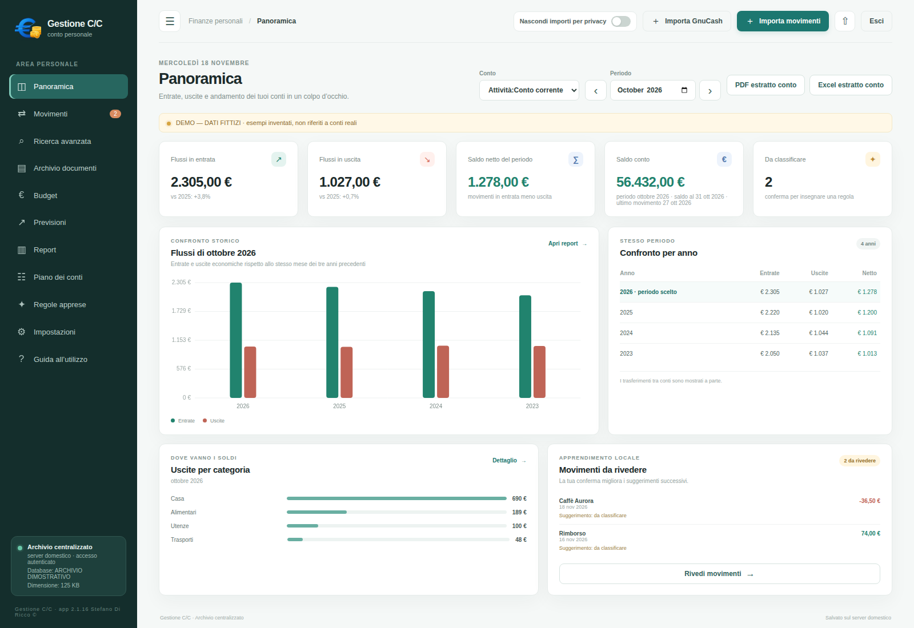
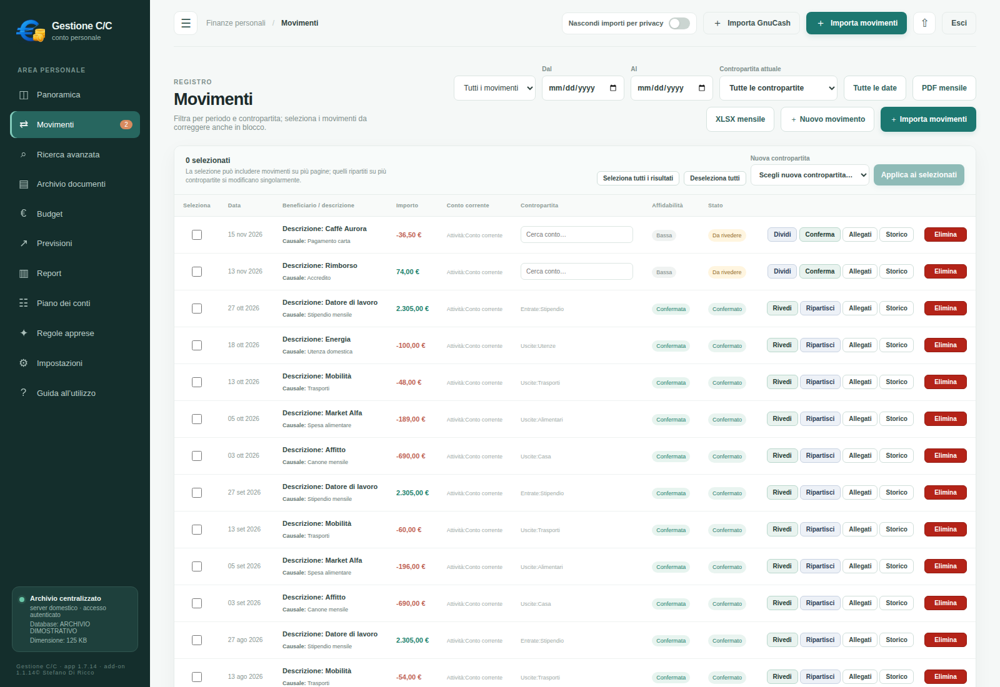
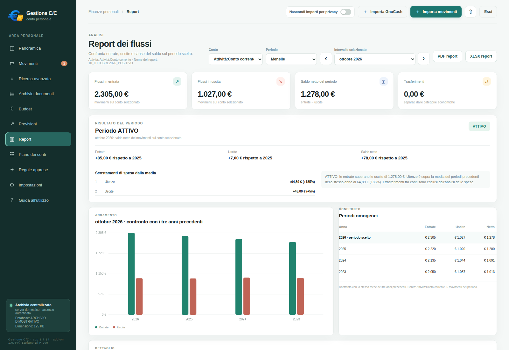

# Gestione C/C — Home Assistant App

  

  <strong>Gestione personale dei conti · Personal finance management</strong> 
  <em>Edizione Home Assistant · Home Assistant edition</em>

**Italiano · English**

## Funzionalità introdotte nella versione 2.1.3

La versione **2.1.3** include la PWA dedicata allo smartphone, in sola lettura, con correzione dei grafici delle entrate per categoria e aggiornamento dei sensori versione:
- Accesso con PIN esistente e sessione smartphone separata.
- Panoramica, entrate, uscite, categorie, movimenti e grafici.
- API mobile con dati ridotti e controlli server-side che impediscono le modifiche contabili.
- PWA con percorso isolato `/mobile/`; interfaccia desktop e database restano invariati.

Dopo l'aggiornamento dell'Home Assistant App, apri `https://<host-lan>:8443/mobile/` dal telefono. La funzione resta LAN-only e richiede il certificato CA HTTPS già installato sul dispositivo.

### Features introduced in version 2.1.3

Version **2.1.3** includes the dedicated read-only smartphone PWA, with a fix for income-by-category charts and updated version sensors:
- Existing PIN authentication with a separate smartphone session.
- Overview, income, expenses, categories, transactions and balances.
- Reduced-data mobile API and server-side controls preventing accounting changes.
- PWA isolated under `/mobile/`; desktop interface and database remain unchanged.

After updating the Home Assistant App, open `https://<lan-host>:8443/mobile/` on your phone. The service remains LAN-only and requires the existing HTTPS CA certificate on the device.

## Novità della versione 2.0.0

Questa distribuzione comprende **tre componenti distinti**, che svolgono ruoli diversi:

- **Home Assistant App (server):** ospita Gestione C/C, l'interfaccia web e il database SQLite persistente.
- **Integrazione HACS facoltativa:** componente separato, con repository e ciclo di versione indipendenti. [Documentazione e installazione](https://github.com/stefanodr/gestione-cc-integration).
- **PWA (Progressive Web App):** permette di installare l'interfaccia come finestra/app sul PC o su un dispositivo compatibile. Non è un programma autonomo e richiede che il server Home Assistant sia raggiungibile.

**Novità documentate nella 2.0.0:** integrazione HACS separata con autenticazione tramite token e certificato CA privata; manifest e icone PWA con istruzioni per Chrome, Edge e Firefox su Windows. I dettagli dell'integrazione sono mantenuti nel [repository dedicato](https://github.com/stefanodr/gestione-cc-integration).

**Guide rapide:** [installazione dell'App](#installazione) · [repository dell'integrazione HACS](https://github.com/stefanodr/gestione-cc-integration) · [installazione PWA](#pwa-e-installazione-come-app-desktop) · [changelog](gestione_cc/CHANGELOG.md).

**Interfaccia smartphone:** disponibile in sola lettura su `/mobile/`, con accesso dedicato e API a dati ridotti. Consulta il [manuale dell'App](gestione_cc/DOCS.md#interfaccia-smartphone-e-registro-accessi).

### What's new in version 2.0.0

This distribution includes **three separate components** with different roles:

- **Home Assistant App (server):** hosts Gestione C/C, its web interface and persistent SQLite database.
- **Optional HACS integration:** a separate component with its own repository and release cycle. [Documentation and installation](https://github.com/stefanodr/gestione-cc-integration).
- **PWA (Progressive Web App):** lets you install the interface as a dedicated app/window on a PC or compatible device. It is not a standalone program and requires the Home Assistant server to be reachable.

**Version 2.0.0 highlights:** separate HACS integration with dedicated-token authentication and private CA certificate; PWA manifest and icons with Chrome, Edge and Firefox for Windows installation instructions. Integration details are maintained in the [dedicated repository](https://github.com/stefanodr/gestione-cc-integration).

**Quick links:** [Install the App](#installation) · [HACS integration repository](https://github.com/stefanodr/gestione-cc-integration) · [Install the PWA](#pwa-and-desktop-app-installation) · [changelog](gestione_cc/CHANGELOG.md).

> [!IMPORTANT]
> **SCHERMATE DIMOSTRATIVE — DATI FITTIZI**
>
> Le immagini mostrate in questo README rappresentano l'interfaccia di Gestione C/C popolata esclusivamente con dati inventati a scopo dimostrativo. Nomi, conti, saldi, date, movimenti e importi non appartengono a utenti reali e non provengono da archivi bancari o GnuCash.

## Anteprima

| Panoramica | Movimenti | Report |
|:---:|:---:|:---:|
|  |  |  |
| Entrate, uscite, saldi e andamento. | Consultazione e classificazione dei movimenti. | Analisi dei flussi e confronti tra periodi. |

## Integrazione Home Assistant tramite HACS

L'integrazione HACS è **facoltativa** e viene distribuita e documentata separatamente dall'App. L'App funziona autonomamente anche senza installare l'integrazione.

Per installazione, configurazione, requisiti, compatibilità, entità, servizi, sicurezza ed esempi aggiornati, consulta il repository dedicato:

**[Apri il repository Gestione C/C – Integrazione Home Assistant](https://github.com/stefanodr/gestione-cc-integration)**

L'integrazione richiede che l'App Gestione C/C sia installata e raggiungibile tramite la rete locale. L'installazione HACS non installa l'App.

## PWA e installazione come app desktop

Gestione C/C può essere aperta come normale pagina web oppure installata come web app in una finestra dedicata. L'installazione non crea un programma Windows autonomo: il browser continua a fornire il motore di esecuzione.

### Prima di installare
1. Apri l'indirizzo HTTPS LAN dell'App, ad esempio `https://192.168.1.27:8443`.
2. Verifica che la CA privata sia installata e attendibile nel sistema operativo/browser.
3. Accedi e controlla che l'interfaccia funzioni correttamente.
4. Installa la web app dal browser. Non usare un indirizzo pubblico o un collegamento che esponga il servizio su Internet.

### Google Chrome
1. Apri Gestione C/C in Chrome.
2. Apri **⋮ → Trasmetti, salva e condividi → Installa pagina come app**; in alcune versioni compare direttamente l'icona Installa nella barra degli indirizzi.
3. Conferma il nome e l'installazione.
4. Apri l'app dal menu Start o dal collegamento creato. Per il desktop, apri la gestione delle app/collegamenti di Chrome e scegli **Crea collegamento** o l'opzione disponibile per aggiungerla al desktop.

### Microsoft Edge
1. Apri Gestione C/C in Edge.
2. Seleziona **⋯ → App → Installa questo sito come app** oppure l'icona di installazione nella barra degli indirizzi.
3. Conferma l'installazione.
4. In `edge://apps`, apri **Dettagli** dell'app e scegli **Aggiungi alla barra delle applicazioni**, **Aggiungi a Start** o **Crea collegamento sul desktop**.

### Mozilla Firefox su Windows
Firefox supporta le web app su Windows a partire dalla versione 143. Se installato dal Microsoft Store, è richiesta la versione 150 o successiva.
1. Apri Gestione C/C in una normale finestra di Firefox.
2. Se compare il pulsante **Aggiungi scheda alla barra delle applicazioni / Web app** nella barra degli indirizzi, selezionalo.
3. Firefox crea una finestra dedicata e aggiunge la web app alla barra delle applicazioni e al menu Start.
4. Questa funzione è disponibile su Windows; non è la procedura PWA Chromium e non è prevista in modalità anonima.

### Icona e collegamento Windows
L'App pubblica icone PNG dedicate da 192×192 e 512×512 pixel con il logo ufficiale (€ blu e monete dorate). Se la finestra d'installazione mostra il logo corretto ma il collegamento desktop continua a visualizzare l'icona generica del browser, può essere necessario correggerla manualmente: clic destro sul collegamento → **Proprietà → Collegamento → Cambia icona**, selezionare il file/icona corretta e confermare. È un comportamento del collegamento o della cache icone di Windows, non un'indicazione che l'icona fornita dal sito sia errata.

### Installazione PWA su tablet Android (procedura verificata su Samsung Galaxy Tab A8)

Su Android la PWA può essere installata anche su tablet. Prima, però, Chrome deve riconoscere come attendibile il certificato HTTPS dell'App.

1. Da un PC, apri Gestione C/C e scarica il **certificato CA privato** dalla sezione Sicurezza/Certificati. Se il browser lascia il download in attesa, puoi utilizzare un'applicazione di download affidabile per salvare il file originale.
2. Trasferisci il file del certificato (ad esempio `.crt` o `.cer`) sul tablet. Una procedura semplice è caricarlo su Google Drive dal PC e scaricarlo da Drive sul tablet.
3. Sul tablet apri **Impostazioni** e cerca **Installa certificato CA**. Sui dispositivi Samsung il percorso e il nome delle voci possono variare in base alla versione di Android/One UI.
4. Seleziona il file CA salvato sul tablet e conferma l'installazione. Procedi soltanto con il certificato CA scaricato dalla propria istanza Gestione C/C e trasferito attraverso un canale fidato: un certificato CA installato diventa una nuova autorità considerata attendibile dal dispositivo.
5. Chiudi e riapri Chrome, quindi visita nuovamente l'indirizzo HTTPS LAN di Gestione C/C. Verifica che la pagina si apra senza avvisi relativi al certificato.
6. Apri il menu **⋮** di Chrome e seleziona **Installa app**. Conferma l'installazione: la PWA viene aggiunta al tablet con la propria icona.
7. Se Chrome continua a proporre soltanto **Crea scorciatoia** oppure segnala che l'app non può essere installata, verifica prima che il certificato sia stato installato correttamente e che la pagina HTTPS non mostri avvisi. La semplice scorciatoia apre il sito nel browser e non equivale all'installazione della PWA.

**Nota:** questa procedura è stata verificata su un Samsung Galaxy Tab A8. Le diciture e i menu possono essere diversi su altri tablet Android. Google Drive è stato usato soltanto per trasferire il file; non è necessario collegare Drive a Gestione C/C.

### Aggiornamenti e dati
- Per aggiornare l'applicazione, aggiorna l'Home Assistant App: non disinstallarla e non cancellarne i dati.
- La PWA è una finestra d'accesso al servizio web, non una copia autonoma dell'archivio.

Guide ufficiali dei browser: [Chrome](https://support.google.com/chrome/answer/9658361), [Microsoft Edge](https://support.microsoft.com/it-it/edge/installare-gestire-o-disinstallare-app-in-microsoft-edge), [Firefox per Windows](https://support.mozilla.org/en-US/kb/web-apps-firefox-windows).
- Non è registrato un service worker: la web app non offre modalità offline e richiede sempre il server Home Assistant raggiungibile.
- Le sessioni e le regole di autenticazione restano quelle dell'applicazione: la PWA non elimina la richiesta PIN quando necessaria.

## Configurazione e primo accesso

- **PIN iniziale:** imposta un codice composto da esattamente sei cifre prima del primo avvio.
- **Hostname:** usa un nome locale raggiungibile dai dispositivi dai quali desideri accedere.
- **Rete LAN:** configura `lan_network` con la subnet effettiva della tua rete. Una configurazione errata può impedire l'accesso oppure non limitare correttamente i client.
- **Certificato HTTPS:** la CA privata deve essere installata e considerata attendibile solo sui dispositivi autorizzati.
- **PIN di bootstrap:** dopo la migrazione iniziale, rimuovi il valore `bootstrap_pin` dalle opzioni dell'App. Il PIN effettivo viene conservato nel database come verificatore derivato, non in chiaro.

Per i dettagli delle opzioni e delle procedure consulta il [manuale dell'App](gestione_cc/DOCS.md).

## Sicurezza e privacy

- Interfaccia HTTPS sulla porta TCP 8443.
- Filtro di rete basato sulla subnet configurata in `lan_network`: impostala e verificala prima di inserire dati personali.
- L'accesso cloud pubblico non è previsto. Non configurare port forwarding, DMZ o reverse proxy esposti a Internet.
- Il PIN è elaborato con PBKDF2-HMAC-SHA256 e salt casuale.
- Cookie di sessione HttpOnly, Secure e SameSite=Strict; protezione CSRF sulle operazioni che modificano i dati.
- Limitazione dei tentativi di accesso e controlli di revisione per ridurre i rischi di accessi ripetuti e sovrascritture silenziose tra sessioni concorrenti.
- I dati contabili restano nel volume persistente dell'App. Solo collegando esplicitamente Google Drive, i file di backup SQLite vengono trasferiti al proprio account Google tramite HTTPS; il database operativo resta sul server Home Assistant.
- La CA privata è una credenziale di fiducia: installala solo sui dispositivi autorizzati e proteggi i backup.

Nessuna applicazione può garantire sicurezza assoluta. Verifica rete, backup e ripristino nel tuo ambiente prima di affidare all'applicazione dati importanti. Non è stato eseguito un audit di sicurezza indipendente.

## Dati, backup e ripristino

- Il database operativo SQLite è conservato nel volume persistente dell'App sul server Home Assistant.
- L'applicazione offre backup ed esportazione in formato JSON e SQLite.
- I backup automatici locali restano disponibili sul server Home Assistant.
- In **Impostazioni → Backup · Google Drive** puoi collegare facoltativamente il tuo account Google. Consulta la [guida passo-passo in italiano e inglese](docs/GOOGLE_DRIVE_BACKUP.md).
- Il collegamento usa un OAuth Client di tipo Desktop e un token generato una tantum con rclone su PC Windows; Gestione C/C conserva il token nel volume dati privato dell'App.
- Se Google Drive è collegato, l'App mantiene un backup di sessione e gli ultimi tre backup notturni (ore 03:00, fuso Europe/Rome).
- Il comando **Esci** completa il salvataggio in coda e avvia il backup di sessione in background solo se l'archivio è cambiato. La chiusura diretta della scheda del browser resta un tentativo best-effort.
- I file SQLite su Google Drive **non sono cifrati**: chiunque abbia accesso al Drive e ai relativi backup può leggerne il contenuto. Proteggi l'account Google e non condividere i file.
- Il ripristino da Google Drive crea prima una copia preventiva locale e poi verifica l'integrità SQLite e la struttura dell'archivio.

La connessione a Google Drive è facoltativa e in uscita: non rende l'interfaccia Gestione C/C accessibile da Internet. Conserva comunque una copia indipendente e verifica periodicamente la procedura di ripristino.

## Aggiornamenti

- Aggiorna Gestione C/C tramite la funzione di aggiornamento delle App di Home Assistant.
- **Non disinstallare l'App per aggiornarla.**
- Non cancellare la cartella dati e non reimportare l'archivio durante un normale aggiornamento.
- Prima di un aggiornamento importante, crea un backup JSON e SQLite e verifica che sia disponibile una copia indipendente.

Per le novità della versione installata consulta le [note di rilascio](CHANGELOG.md).

## Supporto e licenza

- **Manuale:** [gestione_cc/DOCS.md](gestione_cc/DOCS.md)
- **Guida backup Google Drive (IT/EN):** [docs/GOOGLE_DRIVE_BACKUP.md](docs/GOOGLE_DRIVE_BACKUP.md)
- **Changelog:** [CHANGELOG.md](CHANGELOG.md)
- **Segnalazioni:** [GitHub Issues](https://github.com/stefanodr/gestione-cc-home-assistant/issues)
- **Avvisi sulle dipendenze:** [THIRD_PARTY_NOTICES.md](THIRD_PARTY_NOTICES.md)
- **Licenza:** [licenza proprietaria d'uso personale](LICENSE)
- **Licenze commerciali:** [condizioni e richieste](COMMERCIAL-LICENSING.md)

L'uso gratuito è consentito alle persone fisiche per finalità personali e non commerciali, nei limiti della licenza. Gli usi professionali, aziendali e commerciali richiedono un accordo scritto.

Versione Home Assistant App: **2.1.38**. Versione dell'app inclusa: **2.1.38**. L'integrazione HACS ha un versionamento indipendente: consulta il [repository dedicato](https://github.com/stefanodr/gestione-cc-integration).

Copyright © 2026 Stefano Di Ricco (`stefanodr`). Tutti i diritti riservati salvo i permessi espressamente concessi.

Quando apri una segnalazione indica le versioni di Home Assistant e dell'App, l'architettura e i passaggi per riprodurre il problema. **Non allegare database, backup, PIN, certificati privati, cookie o dati bancari reali.** Usa dati dimostrativi.

---

# English

## Overview

**Gestione C/C** is a self-hosted personal finance web application for managing accounts, recording transactions and analysing cash flows. This edition is distributed as a **Home Assistant App** (formerly called an add-on) and stores accounting data in a persistent SQLite database on the Home Assistant host.

It brings income, expenses, balances, categories, budgets and financial trends together in one interface. It also supports importing GnuCash books and transaction files in the supported formats.

It is designed for personal use on a local network and does not require an external cloud service.

> **Important:** this is a Home Assistant App, not a Home Assistant integration, dashboard card or Marketplace plugin. Install it from the Home Assistant App repository catalogue.

## Features

### Financial overview
- Income, expenses and net balance summary for the selected period.
- Account balances and historical trends.
- Cash-flow charts and spending breakdowns by category.
- Account and reporting-period selection.

### Transaction register
- Transaction browsing, search and filters.
- Manual entry and import of supported transaction files.
- Classification and split transactions across multiple accounts or categories.
- Advanced transaction search by text, date range, amount, account and status, with saved filters.
- Import of transaction files in QIF, TXT (QIF structure), OFX, CSV and XLSX formats.
- Chart-of-accounts import from XLSX or CSV using the supplied template.
- PDF, JPEG/JPG and PNG attachments linked to transactions and a standalone document archive: 5 MB per file and 15 MB per transaction; an informational warning appears at 100 MB total archive usage without blocking further uploads.
- Local OCR, indexing and search across the document archive, with editable extracted metadata.
- Append-only history of transaction creation, edits and deletion, including timestamps and before/after values.

### Chart of accounts and classification
- Hierarchical accounts and subaccounts.
- Import of chart of accounts from GnuCash, XLSX or CSV.
- Compatibility with accounts imported from GnuCash.
- Local suggestions and rules based on confirmed classifications.

### Budgets and forecasts
- Budget management, future forecasts and planned-versus-actual comparisons.

### Reports
- Monthly, quarterly, half-yearly and annual analysis.
- Historical comparisons and category variance analysis.
- XLSX report exports and printable PDF preview; use the browser's print dialog to save as PDF.

### Storage and protection
- Persistent SQLite database on the Home Assistant host.
- Six-digit administrator PIN.
- HTTPS connection.
- JSON and SQLite backup and restore, local automatic snapshots and optional Google Drive backup.

> Available features and their exact behaviour depend on the installed version. See the [CHANGELOG](CHANGELOG.md) for release details.

## Requirements

- Home Assistant OS with Supervisor/App store.
- `amd64` or `aarch64` architecture.
- A local network reachable by client devices.
- A local hostname resolvable by clients.
- The correct LAN subnet configured in `lan_network`.
- A modern browser with JavaScript enabled.

## Installation

1. In Home Assistant, open **Settings → Apps**.
2. Open the top-right menu and select **Repositories**.
3. Add the repository:

   `https://github.com/stefanodr/gestione-cc-home-assistant`

4. Refresh the App catalogue, find **Gestione C/C**, and install it.
5. Before the first start, set an initial PIN containing **exactly six digits**.
6. Check the `hostname` and `lan_network` options. The latter must match your actual LAN subnet; do not keep an example value without checking it.
7. Start the App and open:

   `https://<local-hostname>:8443`

   For example, `https://homeassistant.local:8443`, if that hostname resolves on your network.

8. On first access, the browser may warn that the certificate was issued by a private CA. Connect only from your local network, download the CA from the login page/Settings and install it on authorised devices as described in the [App documentation](gestione_cc/DOCS.md).

## Home Assistant integration through HACS

The HACS integration is **optional** and is distributed and documented separately from the App. Gestione C/C works independently without installing the integration.

For current installation instructions, configuration, requirements, compatibility, entities, services, security information and examples, visit the dedicated repository:

**[Open Gestione C/C – Home Assistant Integration](https://github.com/stefanodr/gestione-cc-integration)**

The integration requires the Gestione C/C App to be installed and reachable over the local network. Installing it through HACS does not install the App.

## PWA and desktop app installation

## PWA and desktop app installation

Gestione C/C can be opened as a regular web page or installed as a web app in a dedicated window. Installation does not create a standalone Windows executable: the browser still provides the runtime.

### Before installing
1. Open the App's LAN HTTPS address, e.g. `https://192.168.1.27:8443`.
2. Make sure the private CA is installed and trusted by the operating system/browser.
3. Sign in and verify that the interface works correctly.
4. Install the web app from the browser. Do not use a public URL or expose the service to the Internet.

### Google Chrome
1. Open Gestione C/C in Chrome.
2. Select **⋮ → Cast, save and share → Install page as app**; some versions show an Install icon in the address bar.
3. Confirm the app name and installation.
4. Launch it from the Start menu or its shortcut. To create a desktop shortcut, use Chrome's app/shortcut management and select **Create shortcut** or the available desktop option.

### Microsoft Edge
1. Open Gestione C/C in Edge.
2. Select **⋯ → Apps → Install this site as an app**, or use the install icon in the address bar.
3. Confirm the installation.
4. In `edge://apps`, open the app's **Details** and choose **Pin to taskbar**, **Pin to Start** or **Create desktop shortcut**.

### Mozilla Firefox on Windows
Firefox supports web apps on Windows starting with version 143. If Firefox was installed from the Microsoft Store, version 150 or later is required.
1. Open Gestione C/C in a regular Firefox window.
2. If the **Add tab to taskbar / Web app** button appears in the address bar, select it.
3. Firefox creates a dedicated window and adds the web app to the taskbar and Start menu.
4. This feature is available on Windows; it is different from the Chromium PWA installation flow and is not available in private browsing.

### Icon and Windows shortcut
The App provides dedicated 192×192 and 512×512 PNG icons using the official logo (blue € symbol and gold coins). If the installation dialog shows the correct logo but the desktop shortcut still displays a generic browser icon, Windows may require a manual shortcut adjustment: right-click the shortcut → **Properties → Shortcut → Change Icon**, select the correct icon and confirm. This is a Windows shortcut/icon-cache behaviour, not evidence that the website's icon is missing.

### Installing the PWA on an Android tablet (procedure tested on Samsung Galaxy Tab A8)

The PWA can also be installed on Android tablets. Chrome must first trust the App's HTTPS certificate.

1. On a PC, open Gestione C/C and download the **private CA certificate** from Security/Certificates. If the browser leaves the download pending, use a trusted download manager to save the original file.
2. Transfer the certificate file (for example, `.crt` or `.cer`) to the tablet. One simple method is to upload it to Google Drive from the PC and download it from Drive on the tablet.
3. On the tablet, open **Settings** and search for **Install CA certificate**. On Samsung devices, the menu path and wording may vary with the Android/One UI version.
4. Select the CA file saved on the tablet and confirm installation. Only install the CA certificate downloaded from your own Gestione C/C instance and transferred through a trusted channel: an installed CA becomes a new certificate authority trusted by the device.
5. Close and reopen Chrome, then visit the Gestione C/C LAN HTTPS address again. Check that the page opens without certificate warnings.
6. Open Chrome's **⋮** menu and select **Install app**. Confirm to add the PWA to the tablet with its own app icon.
7. If Chrome still offers only **Create shortcut** or says the app cannot be installed, first check that the certificate was installed correctly and that the HTTPS page shows no warnings. A regular shortcut opens the website in the browser; it is not the same as installing the PWA.

**Note:** this procedure was tested on a Samsung Galaxy Tab A8. Menu names and paths may differ on other Android tablets. Google Drive was used only to transfer the file; Gestione C/C does not need to be connected to Drive.

### Updates and data
- Update the Home Assistant App to update the application; do not uninstall it or delete its data.
- The PWA is a window into the web service, not a separate copy of the archive.

Official browser guides: [Chrome](https://support.google.com/chrome/answer/9658361), [Microsoft Edge](https://support.microsoft.com/en-us/edge/install-manage-or-uninstall-apps-in-microsoft-edge), [Firefox for Windows](https://support.mozilla.org/en-US/kb/web-apps-firefox-windows).
- The service worker does not cache accounting data, API responses, HTML pages or documents. The Home Assistant server must remain reachable.
- The app's normal authentication rules still apply: the PWA does not bypass the PIN when it is required.

## Configuration and first access

- **Initial PIN:** set a code containing exactly six digits before the first start.
- **Hostname:** use a local name reachable from the devices that need access.
- **LAN network:** set `lan_network` to your actual network subnet. An incorrect value may prevent access or fail to restrict clients as intended.
- **HTTPS certificate:** install and trust the private CA only on authorised devices.
- **Bootstrap PIN:** after the initial credential migration, clear `bootstrap_pin` from the App options. The effective PIN is stored in the database as a derived verifier, not in plaintext.

For option details and procedures, see the [App manual](gestione_cc/DOCS.md).

## Security and privacy

- HTTPS interface on TCP port 8443.
- Network filtering based on `lan_network`; configure and verify it before entering personal data.
- Public cloud access is not intended. Do not configure port forwarding, a DMZ or an Internet-facing reverse proxy.
- The PIN is processed with PBKDF2-HMAC-SHA256 and a random salt.
- HttpOnly, Secure and SameSite=Strict session cookies; CSRF protection for state-changing operations.
- Login throttling and revision checks help reduce repeated login attempts and silent concurrent overwrites.
- Accounting data remain in the App's persistent volume. Only when Google Drive is explicitly connected are SQLite backup files sent to the user's Google account over HTTPS; the live database remains on the Home Assistant host.
- Treat the private CA as a trust credential. Install it only on authorised devices and protect backups.

No application can guarantee absolute security. Verify networking, backup and restore in your own environment before relying on the application. No independent security audit is claimed.

## Data, backup and restore

- The live SQLite database is stored in the App's persistent volume on the Home Assistant host.
- The application provides JSON and SQLite backup/export functions.
- Local automatic snapshots remain available on the Home Assistant host.
- Under **Settings → Backup · Google Drive**, you can optionally connect your Google account. See the [step-by-step guide in Italian and English](docs/GOOGLE_DRIVE_BACKUP.md).
- Authorization uses a Desktop OAuth client and a one-time token generated with rclone on a Windows PC; Gestione C/C stores the token in the App's private data volume.
- When Google Drive is connected, the App retains one session backup and the latest three nightly backups (03:00, Europe/Rome).
- **Exit** flushes queued saves and starts the session backup in the background only if the archive has changed. Closing the browser tab remains best-effort.
- Google Drive SQLite files are **not encrypted**. Anyone with access to your Drive and the backup files can read their contents.
- Restore from Google Drive first creates a local pre-restore snapshot, then checks SQLite integrity and archive structure.

Google Drive is optional and uses outbound connections only; it does not make the Gestione C/C web interface accessible from the Internet. Keep an independent backup and periodically verify the restore procedure.

## Updates

- Update Gestione C/C using Home Assistant's App update function.
- **Do not uninstall the App to update it.**
- Do not delete the data directory or re-import the archive during a normal update.
- Before a major update, create JSON and SQLite backups and verify that an independent copy is available.

See the [release notes](CHANGELOG.md) for changes in each version.

## Support and licence

- **Manual:** [gestione_cc/DOCS.md](gestione_cc/DOCS.md)
- **Google Drive backup guide (IT/EN):** [docs/GOOGLE_DRIVE_BACKUP.md](docs/GOOGLE_DRIVE_BACKUP.md)
- **Changelog:** [CHANGELOG.md](CHANGELOG.md)
- **Issues:** [GitHub Issues](https://github.com/stefanodr/gestione-cc-home-assistant/issues)
- **Third-party notices:** [THIRD_PARTY_NOTICES.md](THIRD_PARTY_NOTICES.md)
- **Licence:** [proprietary personal-use licence](LICENSE)
- **Commercial licensing:** [terms and enquiries](COMMERCIAL-LICENSING.md)

Free use is permitted to individuals for personal, non-commercial purposes, subject to the licence terms. Professional, business and commercial uses require a written agreement.

Home Assistant App version: **2.1.38**. Bundled application version: **2.1.38**. The HACS integration is versioned independently; see its [dedicated repository](https://github.com/stefanodr/gestione-cc-integration).

Copyright © 2026 Stefano Di Ricco (`stefanodr`). All rights reserved except where permissions are expressly granted.

When reporting an issue, include Home Assistant and App versions, architecture and reproduction steps. **Never upload databases, backups, PINs, private certificates, cookies or real banking data.** Use fictional demo data.
