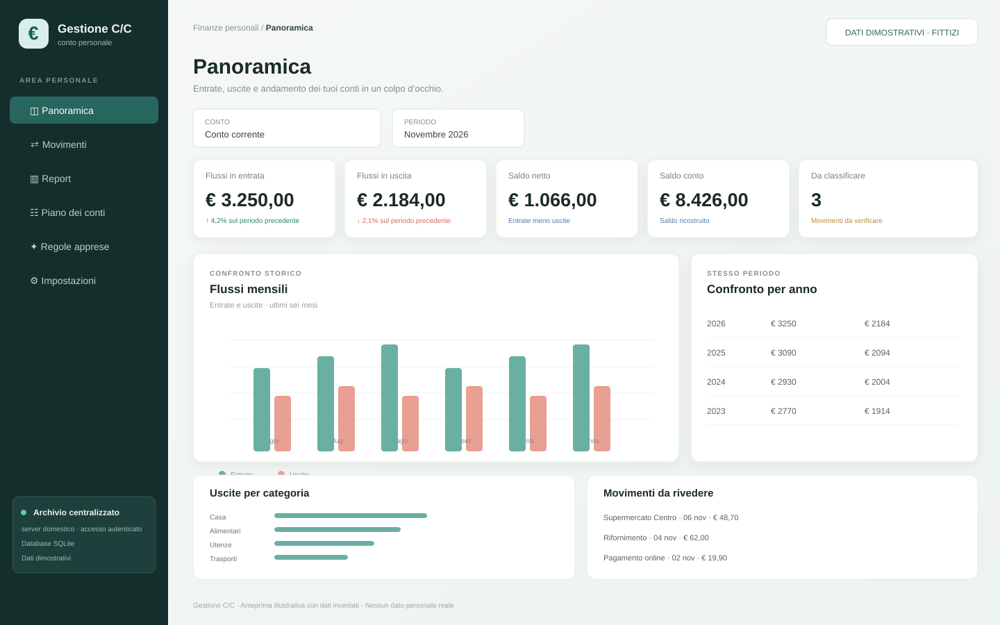
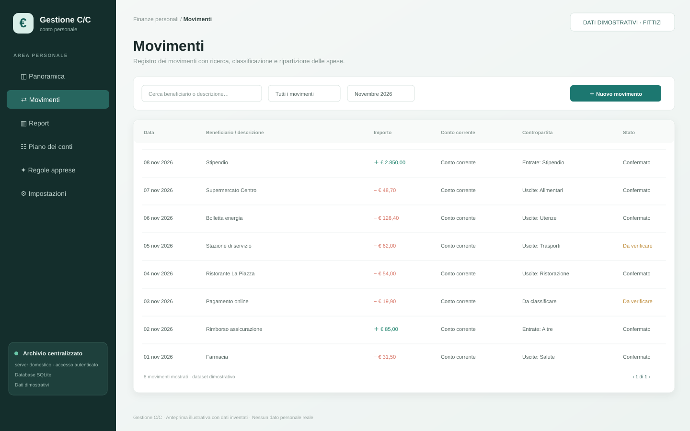
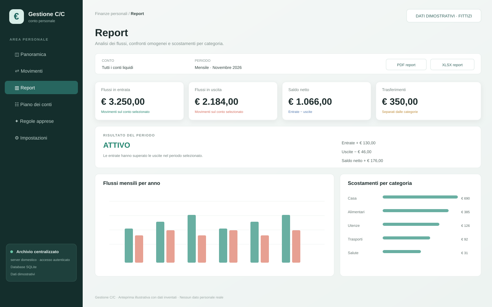
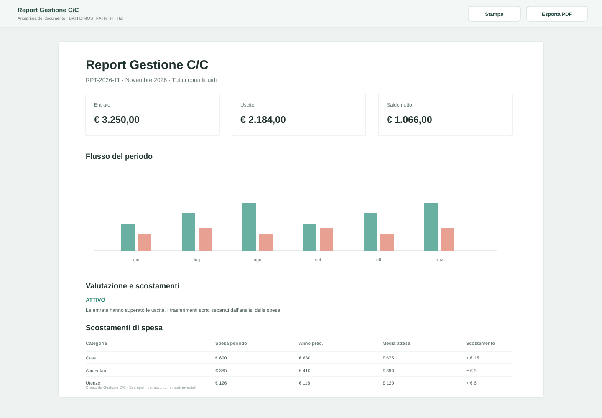

# Gestione C/C

Gestione C/C is a self-hosted personal finance application for Home Assistant. It centralises transactions and account data in a persistent SQLite database, with a PIN-protected HTTPS interface intended for local-network access.

Features include GnuCash and bank-file import, transaction categorisation and splits, a hierarchical chart of accounts, cash-flow dashboards, historical reports, XLSX/PDF output, and JSON/SQLite backup and restore.

**Italiano:** Gestione C/C è un'applicazione per la gestione dei conti personali, con archivio SQLite centralizzato, accesso HTTPS protetto da PIN, importazione GnuCash e movimenti bancari, classificazione, report e backup.

> This is a Home Assistant **App**, not a Marketplace integration or dashboard card. Install it through the Home Assistant App repository catalogue.

## Screenshots

All images are illustrative mockups containing fictional data only.

## Installation

Add `https://github.com/stefanodr/gestione-cc-home-assistant` to **Settings → Apps → Repositories**, refresh the catalogue, then install **Gestione C/C**. Configure a six-digit bootstrap PIN, local hostname and correct LAN CIDR before starting. Full instructions, backup guidance and security notes are in [DOCS.md](DOCS.md).

## Support

Please use the [GitHub issue tracker](https://github.com/stefanodr/gestione-cc-home-assistant/issues). Never post real financial records, backups, PINs, cookies or private keys.

## Version

1.0.0
